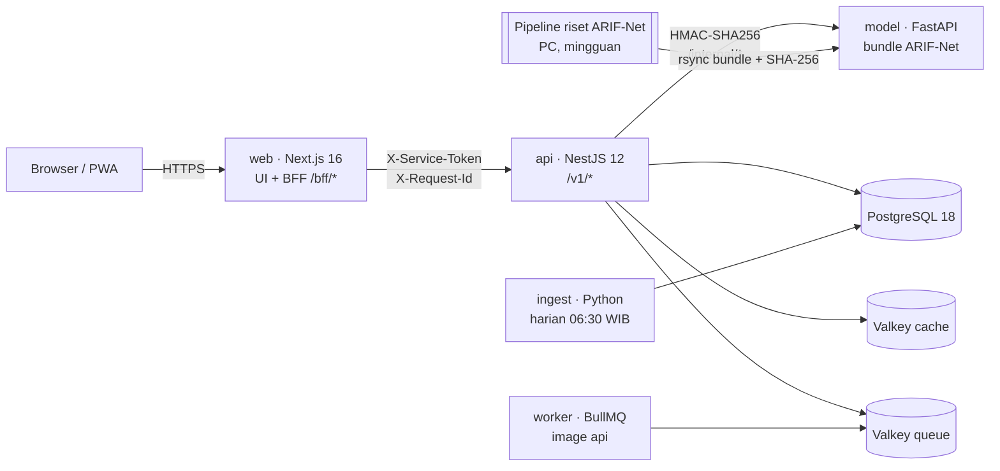

# Arsitektur Kawan Pasar

Ringkasan untuk developer. Spesifikasi lengkap ada di `docs/07`, `08`, `12`, `13`, `15`, dan `17` milik pemilik produk.

## 1. Gambaran besar



| Service    | Tanggung jawab                                                     | Bukan tanggung jawabnya                     |
| ---------- | ------------------------------------------------------------------ | ------------------------------------------- |
| **web**    | Halaman, mode tamu (IndexedDB), BFF yang meneruskan request ke api | Aturan bisnis, akses DB                     |
| **api**    | Semua aturan bisnis, akun, peringatan, penyajian data              | Training model, akses langsung dari browser |
| **worker** | Antrean (peringatan, sinkron artefak)                              | —                                           |
| **model**  | Menyajikan bundle artefak yang sudah diverifikasi                  | Training, akses DB produk, route publik     |
| **ingest** | Mengambil dan memvalidasi harga PIHPS 3 komoditas                  | Berita, iklim, BBM (itu wilayah riset)      |

## 2. Batas jaringan dan keamanan

- **Hanya web yang publik.** api, model, Postgres, dan Valkey berada di jaringan internal tanpa akses internet (`kp-internal`). Di stack lokal, hanya `127.0.0.1:3000` yang dibuka.
- **web → api:** header `X-Service-Token`, dibandingkan dalam waktu konstan. Browser tidak pernah memanggil api langsung; komponen client hanya memanggil `/bff/*`.
- **api → model:** setiap request `/internal/*` ditandatangani:

  ```text
  X-KP-Timestamp: <detik Unix>
  X-KP-Signature: hex(HMAC-SHA256(secret, "<ts>\n<METHOD>\n<path?query>\n<sha256_hex(body)>"))
  ```

  Request ditolak bila jamnya berselisih lebih dari 60 detik. Implementasi TypeScript dan Python dibuktikan sama lewat test vector.

- **Request ID.** `X-Request-Id` dibuat di BFF, diteruskan ke api dan model, lalu muncul di log dan di body error.
- **Web:** CSP dengan nonce per request, HSTS, dan header keamanan lainnya (`apps/web/src/proxy.ts`).
- **Container:** user non-root, rootfs read-only, `cap_drop: ALL`, image dasar dipin by digest, dan di-scan Trivy di CI.
- **Secret** hanya ada di env server. Variabel `NEXT_PUBLIC_*` tidak pernah berisi secret.

## 3. Kontrak

- **Envelope respons** (`packages/contracts`):
  - sukses: `{ data, meta: { request_id, schema_version, generated_at }, provenance?, availability?, limitations, error: null }`
  - gagal: `{ data: null, error: { code, message, request_id } }`
  - Kode error stabil, satu kode = satu status HTTP. Stack trace tidak pernah dikirim ke klien.
- **Uang** selalu rupiah bulat (integer). Tidak ada `float` untuk uang.
- **Nilai yang tidak diketahui** dikirim sebagai `null` dan ditampilkan "—" plus teks, **tidak pernah 0**.
- **Perkiraan** selalu membawa provenance: `model_version`, `dataset_version`, `preprocessing_version`, `data_cutoff`, `artifact_status`. Tidak ada artefak `latest` yang implisit.

## 4. Perhitungan modal

Semua aritmetika ada di **satu tempat**: `packages/domain`. Paket ini dipakai web, dan nanti juga api.

```text
resep (catalog) → harga per bahan (mode) → perkiraan per komoditas (model) → packages/domain
                                                                           → modal per porsi & per hari
```

- **Modal parsial.** Bahan tanpa harga tidak dihitung (tidak dianggap 0). Hasilnya `partial` dengan keterangan cakupan ("3 dari 5 bahan"), dan margin tidak dihitung karena akan terlihat lebih besar dari kenyataan.
- **Perkiraan** hanya berlaku untuk 3 komoditas model. Bahan lain diberi label "tanpa perkiraan".
- **Simulasi** "kalau cabai naik 30%" adalah hitungan biasa, bukan perkiraan model, dan selalu berlabel begitu.

## 5. Mode data dan bundle artefak

| `NEXT_PUBLIC_DATA_MODE` | Harga bahan                                                                        | Label                            |
| ----------------------- | ---------------------------------------------------------------------------------- | -------------------------------- |
| `demo`                  | Harga contoh dari `packages/catalog`                                               | DATA DEMO di setiap angka contoh |
| `live`                  | Harga harian dari ingest (F2). Sampai F2 selesai, bahan berstatus "belum tersedia" | —                                |

| `OUTLOOK_MODE` (model) | Sumber perkiraan                                             | `outlook_status`                            |
| ---------------------- | ------------------------------------------------------------ | ------------------------------------------- |
| `development`          | Bundle demo di `services/model/demo/`                        | `in_development` (UI menampilkan DATA DEMO) |
| `live`                 | `/artifacts/current` → bundle ARIF-Net yang lolos verifikasi | `candidate` / `available` / `missing`       |

Bundle diverifikasi sebelum disajikan. Pemeriksaannya mencakup:

- skema manifest;
- SHA-256 dan ukuran setiap file;
- path yang aman (tetap di dalam bundle);
- identitas run;
- `origin ≤ data_cutoff`;
- rekonstruksi harga.

Bundle yang gagal ditolak, dan bundle lama tetap dipakai.

## 6. Penyimpanan

| Data                              | Tempat                                                  | Fase |
| --------------------------------- | ------------------------------------------------------- | ---- |
| Warung & menu mode tamu           | IndexedDB di perangkat (`apps/web/src/lib/guest-store`) | F1 ✓ |
| Akun, menu tersinkron, peringatan | PostgreSQL via Drizzle ORM                              | F3   |
| Harga harian                      | PostgreSQL (staging → published)                        | F2   |
| Cache & antrean                   | Valkey cache (LRU) dan Valkey queue (noeviction + AOF)  | F0 ✓ |

## 7. Fase rilis

| Fase | Isi                                                              | Status                                      |
| ---- | ---------------------------------------------------------------- | ------------------------------------------- |
| F0   | Monorepo, paket bersama, 4 service, stack lokal, CI, image       | ✓                                           |
| F1   | Golden path mode tamu: Atur Warung → Beranda → Rencana → Rincian | ✓                                           |
| F2   | Ingest harga harian + backfill 2019, Pantau Harga, Q95           | Menunggu perbaikan collector PIHPS (ING-01) |
| F3   | Masuk dengan Google, sinkron tamu, peringatan, Web Push          | Butuh domain (DNS-01)                       |
| F4   | Outlook Harga ★ penuh                                            | —                                           |
| F5   | Konteks, Pelajari, Riset, Mode Analis                            | —                                           |
| F6   | Hardening: uji beban, restore, Lighthouse, audit                 | —                                           |
